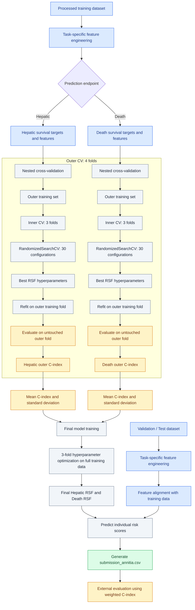

# Training


**1. Model architecture**

Two independent survival prediction models are developed to predict the risk of experiencing the two clinical endpoints. Both models are based on the Random Survival Forest (RSF) algorithm implemented in `scikit-survival`. Each model is trained independently using its corresponding endpoint-specific feature set and survival targets.

**2. Survival target construction**

For each endpoint, survival targets are constructed using the observed event indicator and event time. The follow-up duration is calculated relative to the patient's baseline age (Age_v1):

- Patients experiencing an event: survival time corresponds to the age at event occurrence minus baseline age.
- Patients without an observed event: survival time corresponds to the last observed age minus baseline age. These patients are treated as right-censored observations.
Patients with missing event indicators, missing event times for observed events, or invalid follow-up durations are excluded from the corresponding analysis.

**3. Feature selection and preprocessing**

Before model training, the feature matrices are constructed by removing longitudinal age variables to prevent information leakage.

A dedicated preprocessing pipeline is then applied independently within each cross-validation training fold with a  *Missing-rate filtering* (features with more than 50% missing values are removed) and *median imputation* (better results than iterative imputation).
Importantly, feature selection and imputation are fitted exclusively on the training portion of each fold, preventing information from validation observations from influencing preprocessing.

**4. Nested cross-validation and hyperparameter optimization**

Model performance and hyperparameter selection are assessed using a nested cross-validation strategy.

The procedure consists of two levels:

Outer cross-validation (4 folds)

The dataset is divided into four folds using shuffled K-fold splitting with a fixed random seed.

For each iteration:
- Three folds are used for model development and hyperparameter optimization.
- The remaining fold is kept untouched for independent validation.
- The optimized model is evaluated on this outer validation fold using the Concordance Index (C-index).

This procedure provides an estimate of model generalization performance while limiting optimistic bias associated with hyperparameter selection.

Inner cross-validation (3 folds)

Within each outer training set, a 3-fold cross-validation procedure is used to optimize the Random Survival Forest hyperparameters.

Hyperparameter optimization is performed using RandomizedSearchCV, with 30 randomly sampled parameter combinations.

The search explores the following parameters:

    n_estimators: number of trees in the forest.
    min_samples_leaf: minimum number of samples required in a leaf.
    min_samples_split: minimum number of samples required to split a node.
    max_features: number of features considered when searching for the best split.
    max_depth: maximum depth of each tree.
    max_leaf_nodes: maximum number of leaf nodes.

The best configuration is selected based on the mean inner cross-validation C-index.


**5. Model evaluation**

Model performance and hyperparameter selection are assessed using a nested cross-validation strategy.
The optimized model from each outer fold is evaluated on its corresponding held-out validation fold.
The evaluation metric is the Concordance Index (C-index), calculated using concordance_index_censored.

For each endpoint, the following results are reported:

- C-index for each outer validation fold.
- Mean outer cross-validation C-index.
- Standard deviation across the four outer folds.
- Best hyperparameters selected in each fold.

Additionally, feature selection stability is assessed by recording how frequently each feature is retained across the four outer training folds. This provides an indication of the consistency of the missing-rate filtering procedure.


**6. Final model training**

Following nested cross-validation, two final Random Survival Forest models are trained independently for the hepatic and death endpoints.
For each endpoint, hyperparameter optimization is repeated using 3-fold cross-validation on the complete available training dataset.
These final models are subsequently used to generate predictions for the held-out validation/test dataset.


**7. Risk prediction and submission generation**

The trained models generate an individual risk score for each patient and each clinical endpoint.

The final prediction file contains three columns:

    trustii_id: patient identifier required for submission.
    risk_hepatic_event: predicted hepatic event risk score.
    risk_death: predicted mortality risk score.


The trained models generate an individual risk score for each patient and each clinical endpoint.
The resulting predictions are saved in a CSV file.



## Running


To train our model,

```
python train.py
```

